<p align="center">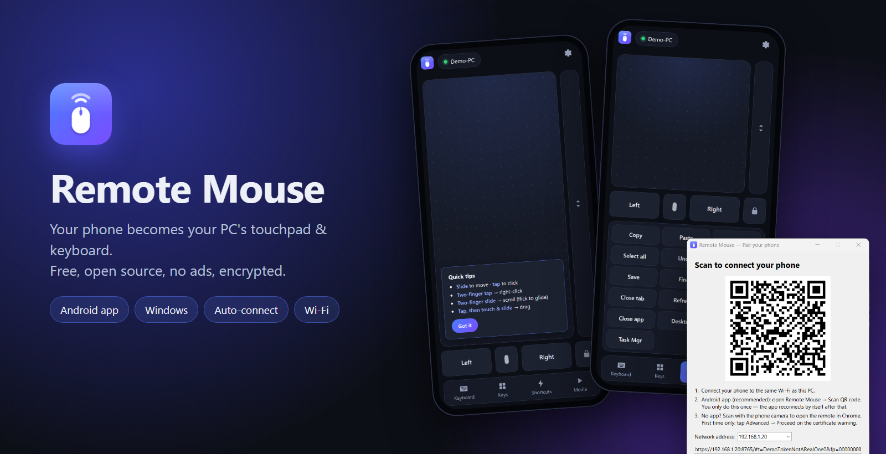</p>

# Remote Mouse

**Use your Android phone as your Windows PC's mouse and keyboard over Wi-Fi.**
Free and open source, with **no ads, no accounts and no cloud**. Your phone talks directly to your PC over your own network, encrypted.

[](https://github.com/ColterPan/remote-mouse/actions/workflows/ci.yml)
[](https://github.com/ColterPan/remote-mouse/releases/latest)

## ⬇️ Download

| | File | What it is |
|---|---|---|
| 🖥️ **PC (recommended)** | **[RemoteMouse-Setup.exe](https://github.com/ColterPan/remote-mouse/releases/latest/download/RemoteMouse-Setup.exe)** | Installer: Start menu, starts with Windows, clean uninstall. No admin needed. |
| 🖥️ PC (portable) | [RemoteMouse.exe](https://github.com/ColterPan/remote-mouse/releases/latest/download/RemoteMouse.exe) | One file, nothing installed. |
| 📱 **Android phone** | **[RemoteMouse.apk](https://github.com/ColterPan/remote-mouse/releases/latest/download/RemoteMouse.apk)** | The phone app (Android 8+). Pair once and it connects by itself. |

<table><tr>
<td></td>
<td><b>📱 Get the app on your phone:</b> scan this QR code with the phone's camera and the APK downloads.<br>
Already installed the PC app? Tray icon → <b>Get the phone app (QR)</b> shows the same code on your PC screen.</td>
</tr></table>

Checksums for every file are in `SHA256SUMS.txt` on the [Releases page](https://github.com/ColterPan/remote-mouse/releases/latest). No Android phone? The PC also serves a [browser version](#no-app-use-the-browser).

---

## Quick start

**1. PC:** run **RemoteMouse-Setup.exe**.
- SmartScreen may say *"Windows protected your PC"*, because the app isn't code-signed (signing certificates cost money). Click **More info → Run anyway**, or [verify the download](#verify-your-download) first.
- When Windows Firewall asks, tick **Private networks** only and click **Allow**.
- The pairing window opens. Remote Mouse now lives in the tray, near the clock.

**2. Phone:** in the pairing window click **Get the phone app** and scan that QR code with your phone's camera (or use the QR above). Open the downloaded **RemoteMouse.apk**.
- Android asks to allow installing apps from your browser or Files app. Allow it for this install. (The app isn't on the Play Store, so there are no ads or trackers.)

**3. Pair once:** in the app, tap **Scan QR code** and point it at the PC's pairing window. **Done.**

From now on, just open the app: it **connects automatically**, even after the PC restarts or gets a new IP address.

---

## Screenshots

| Touchpad | Shortcuts | Media | Settings |
|:---:|:---:|:---:|:---:|
| 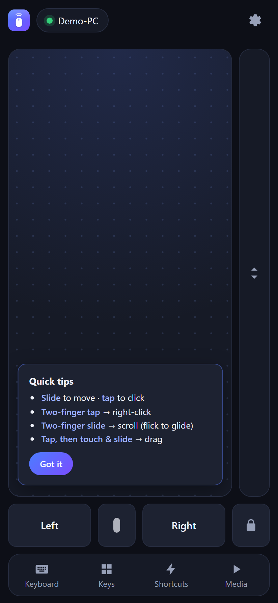 | 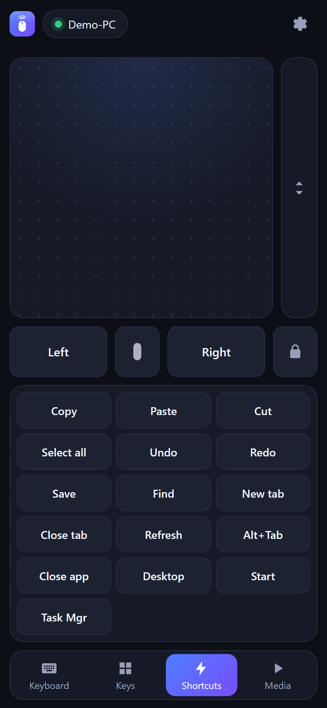 | 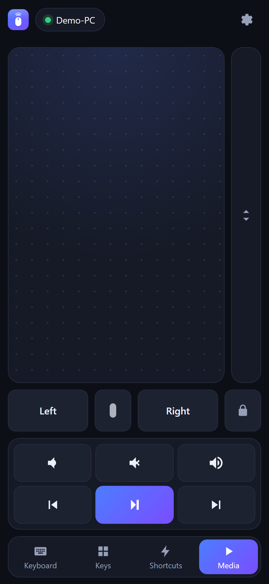 | 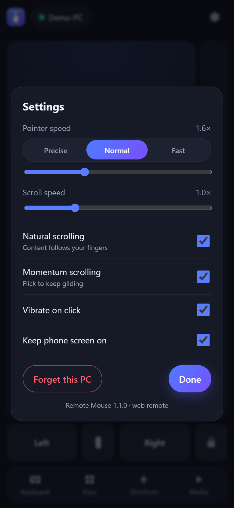 |

| First launch | Your PCs | Special keys | Reconnecting |
|:---:|:---:|:---:|:---:|
| 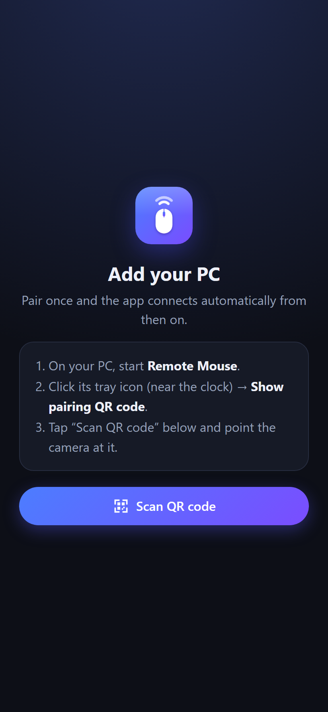 | 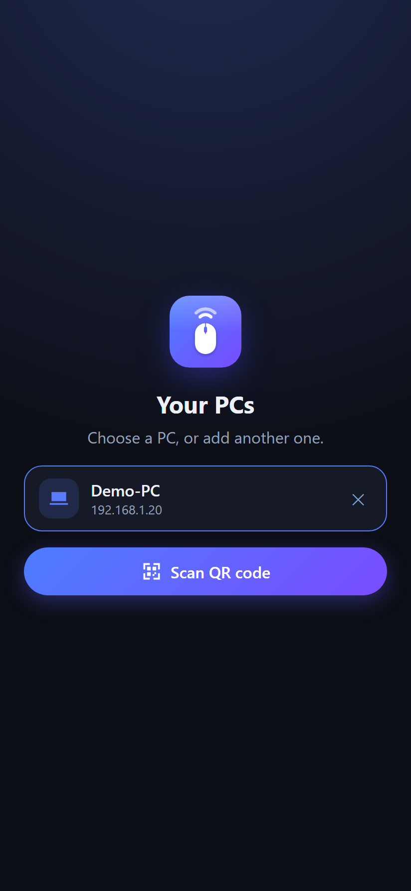 | 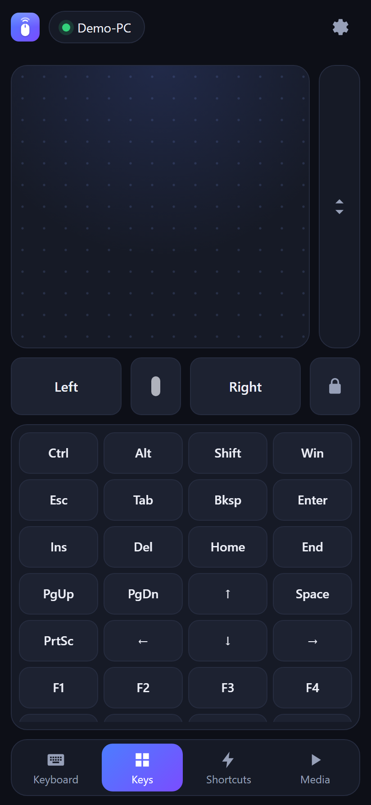 | 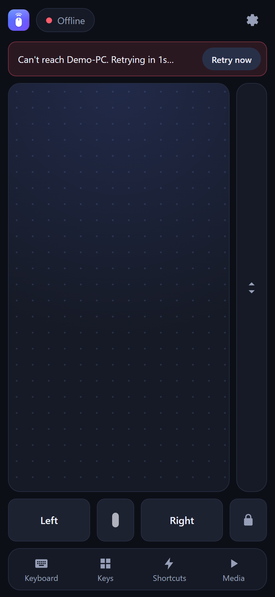 |

<p align="center">
  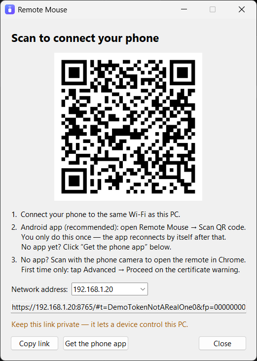
  &nbsp;&nbsp;
  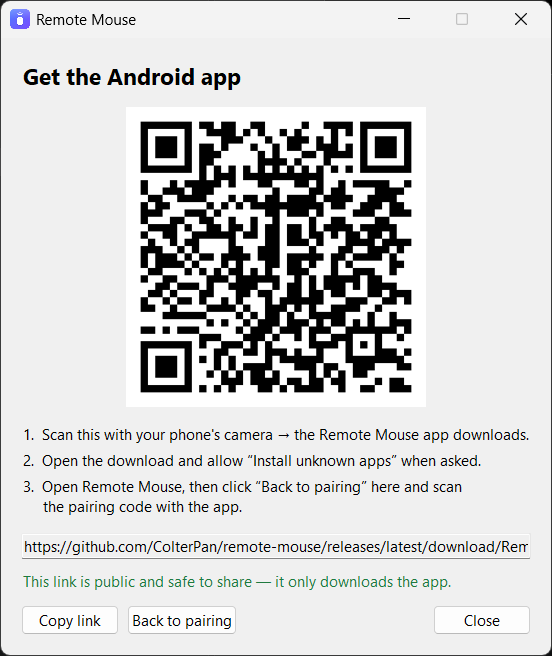
</p>
<p align="center">
  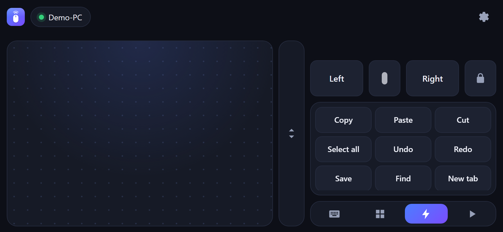
</p>

*Screenshots use demo data (PC "Demo-PC", 192.168.1.20). The QR code above is not a real pairing code.*

---

## How to use it

| Gesture / button | Does |
|---|---|
| Slide one finger | Move the pointer (fast swipes travel further) |
| Tap / tap twice | Left click / double-click |
| Two-finger tap | Right click |
| Three-finger tap | Middle click |
| Two-finger slide | Scroll up/down and sideways. **Flick to keep gliding** (momentum) |
| Tap, then touch again and slide | Drag (move windows, select text) |
| Right-hand strip | One-finger scrolling |
| **Left / middle / Right** buttons | Hold a button with your thumb and move with another finger |
| 🔒 | Drag lock: holds the left button until you tap it again |
| **Keyboard** | Opens your phone keyboard; everything you type goes to the PC (any language, emoji) |
| **Keys** | Esc, Tab, Del, Home/End, PgUp/PgDn, arrows, F1–F12 |
| **Ctrl / Alt / Shift / Win** | Tap to arm, then press a key, e.g. Ctrl + C |
| **Shortcuts** | Copy, Paste, Undo, Redo, Save, Find, Alt+Tab, Win+D, Task Manager… |
| **Media** | Volume, mute, play/pause, next/previous |
| ⚙ **Settings** | Speed presets (Precise / Normal / Fast), scroll speed, natural and momentum scrolling, vibration, keep screen on |
| PC name chip (top) | In the app: switch between PCs or add another |

**PC tray menu:**
- **Show pairing QR code:** pair another phone.
- **Start with Windows**
- **Reset pairing…:** disconnects and un-pairs every phone. Use it if you lose a phone.
- **Quit**

---

## Why it feels smooth

- **The app holds a low-latency Wi-Fi lock** while it's on screen. Phones normally put Wi-Fi to sleep between packets, which makes a remote feel laggy.
- **Movement goes out immediately**, at up to ~125 updates/s, using the lowest-latency touch events the phone offers. In our benchmark the median touch-to-PC delay **halved: 21.7 ms → 11.2 ms**. See [docs/PERFORMANCE.md](docs/PERFORMANCE.md).
- **Pointer speed is averaged over time** and follows a smooth acceleration curve: precise when slow, fast when you flick.
- **Smooth scrolling:** tiny scroll amounts are carried over instead of dropped, and flicks glide with momentum.

## How auto-connect works

When you pair, the app saves the PC's address, its secret pairing code, and the fingerprint of the PC's certificate, all **only on your phone**.

Next launch, it connects to the saved address. If the PC got a new IP, the app searches your Wi-Fi for Remote Mouse PCs (mDNS, like printers and Chromecasts use) and picks yours by its certificate fingerprint.

---

## Security in one minute

- **Only devices on your local network** can connect.
- A phone needs the **secret pairing code** (128-bit random), and 5 wrong guesses lock that device out for a minute.
- **Everything is encrypted.** The app trusts **only your PC's own certificate** ("pinning"), so an impostor can't pretend to be your PC.
- **Pairing codes never leave your phone.** They're excluded from cloud backups and never shown to the app's web page.
- **No ads, tracking, accounts or outbound connections.** The release files are built by GitHub from this public code.

Details: [SECURITY.md](SECURITY.md).

---

## Troubleshooting

| Problem | Fix |
|---|---|
| App says *"Can't reach …"* | Phone and PC must be on the **same Wi-Fi** (guest networks often block devices from seeing each other). Is Remote Mouse running in the PC tray? In **Windows Security → Firewall → Allow an app**, tick *Remote Mouse* for **Private**, and set your Wi-Fi to *Private* in Windows. |
| *"Looking for your PC…"* takes long | The PC changed address and the app is searching. Some routers block this search; then tap the PC chip → **Scan QR code** again. |
| *"Not paired"* | Pairing was reset on the PC. Scan the new QR code. |
| Can't install the APK | Allow *Install unknown apps* for the app you opened it from (Chrome or Files). |
| Pointer doesn't move over Task Manager / admin windows | Windows blocks normal apps from controlling admin windows. That's a Windows security feature. |
| Antivirus flags the .exe | A false positive that's common for Python-built apps. [Verify the checksum](#verify-your-download), or [build it yourself](#build-from-source). |
| Logs | `%APPDATA%\RemoteMouse\remote_mouse.log` |

### Verify your download

Compare with `SHA256SUMS.txt` on the release page:

```powershell
Get-FileHash .\RemoteMouse-Setup.exe -Algorithm SHA256
```

### No app? Use the browser

Scan the PC's QR code with your phone camera. Chrome opens the same remote. Tap **Advanced → Proceed** once on the certificate warning, then use **⋮ → Add to Home screen**. (The app is smoother and never shows that warning.)

---

## Build from source

<details>
<summary><b>PC app (Python)</b></summary>

```powershell
git clone https://github.com/ColterPan/remote-mouse.git
cd remote-mouse\pc
python -m venv .venv; .\.venv\Scripts\activate
pip install -r requirements-dev.txt
python -m playwright install chromium   # for E2E tests, screenshots, icons
python -m remote_mouse                  # run it
```

| Task | Command (in `pc/`) |
|---|---|
| Unit tests + coverage | `pytest --cov` |
| End-to-end user tests (mobile Chrome) | `pytest e2e` |
| Phone UI logic tests | `node --test "web-tests/*.test.mjs"` |
| Lint / security | `ruff check .` · `bandit -c pyproject.toml -r remote_mouse` · `pip-audit -r requirements.txt` |
| Build exe | `pyinstaller remote_mouse.spec --clean --noconfirm` |
| Build installer | `ISCC installer\RemoteMouse.iss` ([Inno Setup](https://jrsoftware.org/isinfo.php)) |
| Re-render all icons from `branding/logo.svg` | `python tools\render_icons.py` |
| Regenerate screenshots | `$env:RM_SCREENSHOTS=1; pytest e2e\test_screenshots.py` then `python tools\pc_screenshot.py; python tools\make_hero.py` |
| Touch latency benchmark | `python tools\touch_latency_bench.py` |

</details>

<details>
<summary><b>Android app (Kotlin)</b></summary>

Needs JDK 17 and the Android SDK (Android Studio, or the command-line tools).

```powershell
cd remote-mouse\android
.\gradlew testDebugUnitTest lintDebug assembleDebug   # → app\build\outputs\apk\debug\app-debug.apk
.\gradlew connectedDebugAndroidTest                    # on-device tests (phone or emulator)
```

The phone UI is **not** duplicated: the build copies `pc/remote_mouse/web` into the APK. Release builds are signed only in GitHub Actions, using encrypted repository secrets.

</details>

### Publishing a new version

```powershell
git tag v1.1.1
git push origin v1.1.1
```

GitHub Actions then:
1. Runs every test.
2. Builds the installer, the portable exe and the signed APK.
3. Publishes them with checksums.

The download links above always point to the newest release.

---

## How it works

```
Android app (WebView UI + native Kotlin)            PC: Remote Mouse (tray app, Python)
┌──────────────────────────────────────┐   Wi-Fi    ┌─────────────────────────────────────┐
│ touchpad.js / gestures.js / keyboard │  TLS 1.2+  │ server.py ─► security.py (allow-list│
│        │ JSON: {"t":"move",…}        │ pinned cert│            token, lockout)          │
│ NativeBridge ─► PinnedSocket (OkHttp)│ ─────────► │          ─► protocol.py (validation)│
│ PcDiscovery (mDNS) · LowLatencyWifi  │ ◄── mDNS ──│ discovery.py (announces fingerprint)│
└──────────────────────────────────────┘            │          ─► input_controller (pynput)│
                                                    └─────────────────────────────────────┘
```

Every source file starts with a comment explaining what it does. Start with:

- [docs/ARCHITECTURE.md](docs/ARCHITECTURE.md): map of every file and thread
- [docs/PROTOCOL.md](docs/PROTOCOL.md): every message the phone can send
- [docs/PLANNING.md](docs/PLANNING.md): options considered and why each choice was made
- [docs/PERFORMANCE.md](docs/PERFORMANCE.md) and [docs/UAT.md](docs/UAT.md): measurements and test results

```
remote-mouse/
├── branding/logo.svg       the one master logo (all icons are rendered from it)
├── pc/                     Windows app: remote_mouse/ (Python), web/ (phone UI), tests/, e2e/, installer/
├── android/                Android app (Kotlin): native shell + bundled phone UI
├── docs/                   architecture, protocol, planning, performance, UAT, screenshots
└── .github/                CI, releases, Dependabot
```

## Roadmap

- [x] Wi-Fi remote, PC app, browser remote (v1.0)
- [x] Android app with auto-connect, new logo, smoother motion, installer (v1.1)
- [ ] Bluetooth mode (the phone acts as a real Bluetooth mouse and keyboard; works at the login screen)
- [ ] Per-device pairing keys with individual revoke

## License

[MIT](LICENSE): free to use, change and share.
